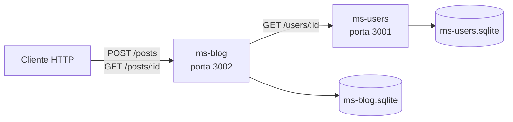
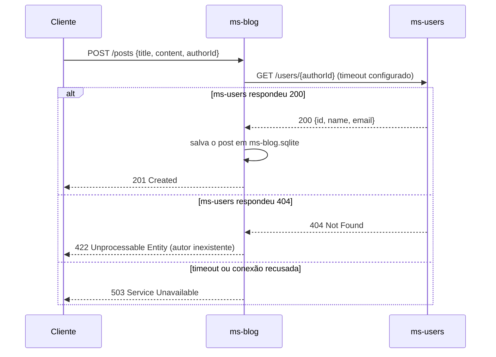

# 01 · Arquitetura de Microsserviços: ms-users e ms-blog

> **Etapa 1 — Desenho da arquitetura e setup inicial**
>
> Este documento explica **por que** o projeto está dividido em dois serviços e **como** eles conversam entre si. A organização das pastas está em [02-estrutura-de-pastas.md](./02-estrutura-de-pastas.md) e a configuração do ambiente em [03-configuracao-inicial.md](./03-configuracao-inicial.md).

---

## 1. O problema que estamos resolvendo

Queremos um blog com cadastro de autores e publicação de posts. Esse sistema pode ser construído de duas formas:

- **Monolito**: um único programa, um único deploy, um único banco.
- **Microsserviços**: serviços independentes, cada um com seu código, seu deploy e seus dados.

Este projeto usa microsserviços de forma deliberadamente enxuta: **dois serviços**. O objetivo didático não é criar um sistema grande, e sim ver como **cada decisão de arquitetura muda a forma de testar**. Quando o sistema é dividido, surgem fronteiras de rede, dados distribuídos e falhas parciais, e cada uma delas exige uma estratégia de teste própria.

---

## 2. Monolito x microsserviços

| Aspecto | Monolito | Microsserviços |
|---|---|---|
| Deploy | Um único artefato | Cada serviço é publicado de forma independente |
| Banco de dados | Normalmente um banco compartilhado | Um banco por serviço |
| Comunicação interna | Chamada de função, em memória | Chamada de rede (HTTP, mensagens) |
| Falhas | Costumam derrubar o sistema inteiro | Falha parcial: um serviço pode cair enquanto o outro continua |
| Complexidade | Concentrada no código | Deslocada para a operação (rede, contratos, observabilidade) |
| Testes | Testes de módulos e da aplicação inteira | Testes por serviço, mais testes das fronteiras entre eles |

**Conclusão:** microsserviços não são "melhores" em geral. Eles trocam complexidade de desenvolvimento por complexidade de operação, e essa troca só compensa quando há domínios, equipes ou escalas diferentes. Aqui usamos o modelo para estudar as fronteiras, não por necessidade de escala.

---

## 3. Como dividimos o domínio

Cada microsserviço deve corresponder a um **contexto delimitado** (*bounded context*): um pedaço do negócio com regras, linguagem e dados próprios.

| | **ms-users** | **ms-blog** |
|---|---|---|
| Porta padrão | `3001` | `3002` |
| Responsabilidade | Cadastrar e consultar usuários (os autores) | Criar e consultar posts |
| Dados que possui | Tabela `users` | Tabela `posts` |
| Guarda do autor | Nome, e-mail, data de cadastro | Somente o `authorId` (um número) |
| Não faz | Nada relacionado a posts | Não guarda nome nem e-mail de autor |

**Regra central: cada serviço é dono dos seus dados.** Se o ms-blog precisa saber o nome de um autor, ele **não copia** a tabela de usuários. Ele pergunta ao ms-users no momento em que precisa da informação. Isso mantém uma única fonte da verdade para cada dado.

---

## 4. Um banco de dados por serviço

Em um monolito, é comum que todas as tabelas fiquem no mesmo banco e que uma consulta junte (`JOIN`) dados de várias áreas. Em microsserviços, isso deixa de ser possível entre serviços:

- O ms-blog **não consegue** fazer `JOIN` com a tabela `users`, porque ela está em outro banco.
- A integridade entre os dois serviços passa a ser garantida **pela API**, e não por uma chave estrangeira (`FOREIGN KEY`).

### Por que SQL com SQLite?

Usamos um banco SQL, como pedido. A escolha específica é o **SQLite**, pelos seguintes motivos:

1. **Zero infraestrutura:** o banco é um arquivo. Ninguém precisa instalar um servidor para estudar o projeto.
2. **SQL de verdade:** as consultas são as mesmas que funcionariam no PostgreSQL ou no MySQL.
3. **Testes rápidos:** nos testes de integração, o SQLite roda **em memória** (`:memory:`), sem efeitos colaterais entre execuções.
4. **Um arquivo por serviço:** cada serviço recebe seu próprio caminho pela variável de ambiente (`USERS_DB_PATH` e `BLOG_DB_PATH`), o que reforça a regra de dados isolados.

Como o SQL ficará restrito à camada de *repositórios* (explicada no documento 02), trocar o SQLite por outro banco no futuro afetaria apenas essa camada.

### Esquema planejado

O esquema abaixo é o **desenho** da Etapa 1. Ele será implementado nas etapas seguintes.

```sql
-- Banco do ms-users (services/ms-users/data/ms-users.sqlite)
CREATE TABLE users (
  id         INTEGER PRIMARY KEY AUTOINCREMENT,
  name       TEXT    NOT NULL,
  email      TEXT    NOT NULL UNIQUE,
  created_at TEXT    NOT NULL
);

-- Banco do ms-blog (services/ms-blog/data/ms-blog.sqlite)
CREATE TABLE posts (
  id         INTEGER PRIMARY KEY AUTOINCREMENT,
  title      TEXT    NOT NULL,
  content    TEXT    NOT NULL,
  author_id  INTEGER NOT NULL,  -- referência LÓGICA ao ms-users: não existe FOREIGN KEY entre bancos
  created_at TEXT    NOT NULL
);
```

---

## 5. Comunicação entre os serviços

Existem dois estilos principais de comunicação entre microsserviços.

### 5.1 Síncrona: requisição e resposta (HTTP/REST)

O serviço que precisa de uma informação faz uma chamada HTTP e **espera** a resposta.

- **Vantagens:** simples de entender, fácil de depurar com um cliente HTTP, resposta imediata.
- **Desvantagens:** cria **acoplamento temporal**. Se o ms-users estiver fora do ar, o ms-blog também não consegue concluir a operação que depende dele.

### 5.2 Assíncrona: mensagens e eventos

O serviço publica um evento (por exemplo, `UsuarioCadastrado`) em um *broker* de mensagens, e os outros serviços reagem a ele quando puderem.

- **Vantagens:** desacoplamento forte entre os serviços e tolerância maior a indisponibilidade.
- **Desvantagens:** exige um broker (RabbitMQ, Kafka etc.), introduz **consistência eventual** (o dado pode demorar a chegar) e torna os testes mais complexos.

### 5.3 Escolha desta etapa

Usamos **REST síncrono** para a comunicação entre ms-blog e ms-users, pelos motivos abaixo:

1. Na criação de um post, precisamos de uma **resposta imediata**: o autor existe ou não existe? Esse é o cenário natural de requisição e resposta.
2. É o modelo mais fácil de **testar** com Supertest e de compreender em sala de aula.
3. Mensageria exigiria infraestrutura extra, o que desviaria o foco do estudo de testes.

Eventos ficam documentados como **evolução possível**, e não como parte desta etapa.

### 5.4 Visão geral da comunicação



Repare nas setas: o cliente nunca fala diretamente com o banco, e o ms-blog nunca acessa o banco do ms-users. **A única forma de um serviço obter dados do outro é pela API.**

### 5.5 Contrato de API planejado

O **contrato** é o acordo público entre dois serviços: quais rotas existem, quais dados trafegam e quais respostas são possíveis. Ele é a referência para os testes.

**ms-users (porta 3001)**

| Método | Rota | Descrição | Respostas possíveis |
|---|---|---|---|
| `POST` | `/users` | Cadastra um usuário | `201` criado · `400` dados inválidos · `409` e-mail já cadastrado |
| `GET` | `/users/:id` | Retorna um usuário | `200` encontrado · `404` não encontrado |
| `GET` | `/health` | Informa se o serviço está no ar | `200` |

**ms-blog (porta 3002)**

| Método | Rota | Descrição | Respostas possíveis |
|---|---|---|---|
| `POST` | `/posts` | Cria um post para um autor existente | `201` criado · `400` dados inválidos · `422` autor inexistente · `503` ms-users indisponível |
| `GET` | `/posts` | Lista os posts | `200` |
| `GET` | `/posts/:id` | Retorna um post com os dados do autor | `200` encontrado · `404` não encontrado · `503` ms-users indisponível |
| `GET` | `/health` | Informa se o serviço está no ar | `200` |

Convenções adotadas:

- **`400` x `422`:** `400` significa que o *formato* da requisição é inválido (campo faltando, e-mail malformado). `422` significa que o formato está correto, mas o *conteúdo* não pode ser processado (o autor informado não existe).
- **`503`:** indica que uma dependência está indisponível. Ele é diferente de `422`: o problema não está nos dados enviados, e sim na infraestrutura.
- **Formato JSON:** a API usa `camelCase` (`createdAt`, `authorId`). O banco usa `snake_case` (`created_at`, `author_id`). A conversão acontece na camada de repositório, e não no restante da aplicação.

**Exemplo de troca de mensagens**

```http
POST /users HTTP/1.1
Content-Type: application/json

{ "name": "Ana Souza", "email": "ana@exemplo.com" }
```

```json
// 201 Created
{
  "id": 1,
  "name": "Ana Souza",
  "email": "ana@exemplo.com",
  "createdAt": "2026-11-08T12:00:00.000Z"
}
```

---

## 6. Fluxo completo: criar um post

Este é o fluxo que envolve os dois serviços e que mais exige cuidado em testes. Ele aparece em três cenários.



Passo a passo:

1. O cliente envia os dados do post, incluindo `authorId`.
2. Antes de gravar qualquer coisa, o ms-blog **valida o autor** consultando o ms-users.
3. Se o autor existe, o post é salvo no banco do ms-blog e a resposta é `201`.
4. Se o autor não existe, nada é salvo e a resposta é `422`.
5. Se o ms-users não responde dentro do tempo limite, nada é salvo e a resposta é `503`.

Note que o ms-blog **não grava nada antes de validar o autor**. Isso evita posts órfãos, ou seja, posts apontando para um autor que não existe.

---

## 7. O custo da distribuição: falhas

Quando a comunicação passa pela rede, qualquer chamada pode falhar, demorar ou responder algo inesperado. Por isso, a arquitetura precisa tratar estes pontos:

- **Timeout:** o ms-blog não espera indefinidamente. O limite é definido em `USERS_SERVICE_TIMEOUT_MS`.
- **Erro de domínio x erro de infraestrutura:** `422` (o autor não existe) e `503` (o ms-users está fora) são problemas diferentes e devem produzir respostas diferentes. Confundi-los dificulta o diagnóstico e os testes.
- **Acoplamento temporal:** se o ms-users cai, a criação de posts também falha. Mecanismos como *retry*, *circuit breaker*, cache ou eventos mitigam esse problema, mas ficam como evolução documentada.
- **Falha parcial:** a leitura de posts continua funcionando mesmo que o ms-users esteja fora, desde que a resposta não dependa dos dados do autor. Essa decisão é tomada no contrato da rota.

---

## 8. O que isso muda nos testes

A divisão em serviços muda a forma de testar. A tabela abaixo organiza os níveis que vamos usar.

| Nível | Pergunta que responde | Onde fica | O que é real | O que é substituído |
|---|---|---|---|---|
| **Unitário** | A regra de negócio está correta? | `tests/unit/` | Código do próprio serviço | Repositório e cliente HTTP (dublês) |
| **Integração** | A rota HTTP funciona com o banco? | `tests/integration/` | Express, rotas e SQLite em memória | ms-users (substituído por um dublê) |
| **Contrato** *(evolução)* | ms-blog e ms-users concordam no formato das respostas? | — | Os dois lados do contrato | — |
| **Ponta a ponta** *(evolução)* | O fluxo completo funciona com todos os serviços no ar? | — | Tudo | Nada |

**Ideia central:** a **fronteira de rede** é o ponto em que os testes precisam de um dublê. Por isso o ms-blog isola toda a chamada ao ms-users em um único arquivo, `clients/users.client.js`. Nos testes, basta substituir esse cliente para controlar, com precisão, as respostas do "outro serviço", inclusive as falhas (timeout, `500`, conexão recusada).

> **Dublê** (*test double*) é um termo genérico para um objeto que se passa por uma dependência real durante o teste. *Mock*, *stub* e *fake* são tipos de dublês.

---

## 9. Decisões tomadas nesta etapa

| Decisão | Escolha | Motivo |
|---|---|---|
| Organização do código | Monorepo com npm workspaces | Um único repositório, um único `node_modules` na raiz, serviços independentes |
| Linguagem | JavaScript com módulos ES (`import`/`export`) | Pedido no enunciado; `"type": "module"` no `package.json` |
| Runtime | Node.js 22 (versão fixada no `.nvmrc`) | Versão LTS, estável para a aula |
| Banco de dados | SQL com SQLite, um arquivo por serviço | Zero infraestrutura e isolamento de dados |
| Comunicação | REST síncrono (HTTP + JSON) | Resposta imediata e modelo fácil de testar |
| Framework HTTP | Express (instalado na Etapa 2) | Padrão amplamente conhecido e bem suportado pelo Supertest |
| Testes unitários | Vitest, projeto `unit` | Rápidos e sem dependências externas |
| Testes de integração | Vitest, projeto `integration`, com Supertest | Testam as rotas HTTP com banco real em memória |

---

## 10. Glossário rápido

- **Microsserviço:** serviço pequeno, com responsabilidade única e dados próprios, implantado de forma independente.
- **Contexto delimitado (*bounded context*):** fronteira de um domínio do negócio, com regras e linguagem próprias.
- **Contrato:** descrição pública das rotas, dos dados e das respostas que um serviço oferece.
- **Acoplamento temporal:** dependência de disponibilidade. Um serviço só funciona se o outro estiver no ar naquele momento.
- **Monorepo:** um único repositório que contém vários pacotes ou serviços.
- **Dublê (*test double*):** substituto controlado de uma dependência real, usado em testes.
