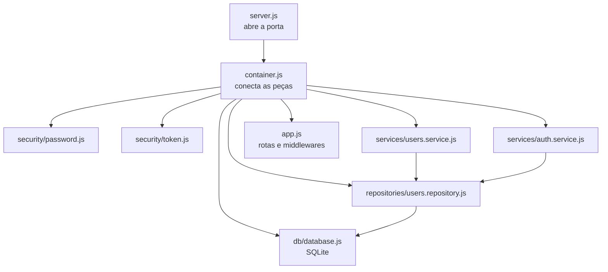

# 01 · Infraestrutura do ms-users

> **Etapa 2 — Microsserviço de Usuários (ms-users)**
>
> Este documento explica a infraestrutura do serviço: o `package.json` local, a conexão com o banco, a configuração, a montagem da aplicação e o encerramento do servidor. A autenticação e o CRUD estão em [02-crud-e-autenticacao.md](./02-crud-e-autenticacao.md). Os testes unitários estão em [03-testes-unitarios.md](./03-testes-unitarios.md).

---

## 1. Objetivo desta parte

Antes de escrever uma rota, precisamos responder a perguntas de infraestrutura:

- Como o serviço lê a configuração e falha se ela estiver errada?
- Onde fica o banco e como a tabela é criada?
- Como as peças são conectadas sem que cada módulo conheça os outros?
- Como separar a aplicação (que pode ser testada) do servidor (que abre a porta)?

A resposta a essas perguntas define a forma do projeto. Se a infraestrutura for bem separada, os testes da próxima parte não precisam de nada disso para rodar.

---

## 2. Mapa dos arquivos da infraestrutura

| Arquivo | Responsabilidade | Conhece HTTP? | Conhece o banco? |
|---|---|---|---|
| `package.json` | Dependências e scripts do serviço | — | — |
| `src/config.js` | Lê e valida o ambiente | Não | Não |
| `src/db/database.js` | Abre o SQLite e cria a tabela | Não | Sim |
| `src/container.js` | Conecta as peças (*composition root*) | Não | Sim |
| `src/app.js` | Monta as rotas e os middlewares | Sim | Não |
| `src/server.js` | Abre a porta e encerra o processo com elegância | Não | Não |
| `src/errors/app-error.js` | Define os erros da aplicação | Não | Não |

Repare na última coluna: só `database.js` e `container.js` conhecem o banco. Esse isolamento é o que permite trocar o SQLite no futuro sem reescrever as regras de negócio.

### Árvore real do serviço após a Etapa 2

```text
services/ms-users/
├── package.json
├── src/
│   ├── server.js                      ← abre a porta (único arquivo com listen)
│   ├── container.js                   ← conecta as peças (composition root)
│   ├── app.js                         ← rotas e middlewares, sem porta
│   ├── config.js                      ← lê e valida o ambiente
│   ├── db/
│   │   └── database.js                ← abre o SQLite e cria a tabela
│   ├── errors/
│   │   └── app-error.js               ← hierarquia de erros com status HTTP
│   ├── security/
│   │   ├── password.js                ← hash e verificação com scrypt
│   │   └── token.js                   ← emissão e verificação de JWT
│   ├── validation/
│   │   └── users.validation.js        ← validação e normalização das entradas
│   ├── repositories/
│   │   └── users.repository.js        ← único lugar com SQL
│   ├── services/
│   │   ├── users.service.js           ← regras do CRUD de usuários
│   │   └── auth.service.js            ← regras do login
│   ├── controllers/
│   │   ├── users.controller.js
│   │   └── auth.controller.js
│   ├── routes/
│   │   ├── users.routes.js
│   │   └── auth.routes.js
│   └── middlewares/
│       ├── authenticate.js            ← exige token válido nas rotas protegidas
│       └── error-handler.js           ← converte erros em respostas JSON
└── tests/
    └── unit/
        ├── doubles/index.js           ← stubs reutilizáveis
        ├── users.service.test.js
        ├── auth.service.test.js
        ├── authenticate.middleware.test.js
        └── security.test.js
```

Em relação ao plano do documento 02 da Etapa 1, a estrutura ganhou alguns arquivos que não estavam previstos: `auth.service.js`, `security/`, `validation/`, `errors/` e `container.js`. Esses acréscimos separam responsabilidades que, sem eles, ficariam misturadas. O plano era um mapa, e o código mostrou que algumas separações valiam a pena.

A pasta `tests/integration/` ainda não existe. Ela será criada quando os testes de integração forem escritos.

---

## 3. O `package.json` do serviço

```json
{
  "name": "@blog/ms-users",
  "version": "1.0.0",
  "private": true,
  "type": "module",
  "scripts": {
    "start": "node --env-file=../../.env src/server.js",
    "dev": "node --env-file=../../.env --watch src/server.js"
  },
  "dependencies": {
    "better-sqlite3": "^12.11.1",
    "express": "^5.2.1",
    "jsonwebtoken": "^9.0.3"
  }
}
```

### Pontos importantes

**Dependências de execução ficam no serviço, e não na raiz.** A raiz só tem ferramentas de teste (Vitest, Supertest). Quem precisa do Express e do driver do SQLite é o ms-users, então essas dependências ficam aqui. Com os workspaces do npm, tudo continua instalado em um único `node_modules` na raiz.

**`--env-file=../../.env`.** Os scripts rodam com a pasta do serviço como diretório atual, por isso o caminho do `.env` sobe dois níveis até a raiz do projeto. O Node.js 22 lê o arquivo sem depender do pacote `dotenv`.

**`--watch` no script `dev`.** O Node reinicia o processo quando um arquivo muda. É útil durante o desenvolvimento e não deve ser usado em produção.

**Versões:**

| Pacote | Por que este pacote | Observação |
|---|---|---|
| `better-sqlite3` | Driver SQLite síncrono e rápido, com API simples | É um módulo nativo, mas instala com binários prontos na maioria dos sistemas |
| `express` | Framework HTTP mais conhecido do ecossistema Node.js | Versão 5, que trata erros de funções `async` automaticamente |
| `jsonwebtoken` | Implementação padrão de JWT para Node.js | Usada para assinar e verificar tokens |

> Por que não usamos `bcrypt` para as senhas? Ele também é um módulo nativo. Como o Node.js já traz o `scrypt`, que é um algoritmo de hash resistente a ataques de força bruta, a dependência extra não se justifica. Veja a seção 9 do documento 02.

---

## 4. Configuração: `src/config.js`

O serviço lê a configuração de **uma única função**, e nenhum outro arquivo usa `process.env` diretamente.

```js
export function loadConfig(env = process.env) {
  const jwtSecret = env.JWT_SECRET ?? '';

  if (jwtSecret.length < MIN_JWT_SECRET_LENGTH) {
    throw new Error(
      `JWT_SECRET é obrigatório e deve ter pelo menos ${MIN_JWT_SECRET_LENGTH} caracteres`,
    );
  }

  return Object.freeze({
    nodeEnv: env.NODE_ENV || 'development',
    port: parsePositiveInteger(env.USERS_SERVICE_PORT, 'USERS_SERVICE_PORT', DEFAULT_PORT),
    dbPath: env.USERS_DB_PATH || DEFAULT_DB_PATH,
    jwt: Object.freeze({
      secret: jwtSecret,
      expiresInSeconds: parsePositiveInteger(env.JWT_EXPIRES_IN, 'JWT_EXPIRES_IN', DEFAULT_JWT_EXPIRES_IN_SECONDS),
    }),
  });
}
```

### Decisões

**Falhar cedo (*fail fast*).** Se o `JWT_SECRET` estiver ausente ou for curto demais, o processo para na inicialização com uma mensagem clara. A alternativa seria aceitar o valor e descobrir o problema só quando o primeiro token fosse emitido, o que é muito mais difícil de diagnosticar.

**Parâmetro `env` com valor padrão.** A função recebe o ambiente como argumento, e o padrão é `process.env`. Assim, qualquer teste pode chamar `loadConfig({ JWT_SECRET: '...' })` sem alterar o ambiente da máquina.

**Objeto congelado.** `Object.freeze` impede que outro módulo altere a configuração em tempo de execução. Uma configuração que muda durante a execução é uma fonte comum de bugs difíceis.

**Valores padrão para o que é seguro.** Porta, caminho do banco e validade do token têm padrões. O segredo do JWT **não tem padrão**, porque um segredo padrão conhecido por todos tornaria qualquer token forjável.

---

## 5. Banco de dados: `src/db/database.js`

```js
export function openDatabase(filePath) {
  const isInMemory = filePath === IN_MEMORY;

  if (!isInMemory) {
    mkdirSync(dirname(filePath), { recursive: true });
  }

  const db = new Database(filePath);
  db.pragma('foreign_keys = ON');

  if (!isInMemory) {
    db.pragma('journal_mode = WAL');
  }

  db.exec(SCHEMA);
  return db;
}
```

### O esquema

```sql
CREATE TABLE IF NOT EXISTS users (
  id            INTEGER PRIMARY KEY AUTOINCREMENT,
  name          TEXT    NOT NULL,
  email         TEXT    NOT NULL UNIQUE,
  password_hash TEXT    NOT NULL,
  created_at    TEXT    NOT NULL
);
```

Três detalhes merecem atenção:

- **`email TEXT NOT NULL UNIQUE`.** A restrição `UNIQUE` é a **segunda barreira** contra e-mails duplicados. A primeira é a checagem no service. O banco é a última linha de defesa, porque duas requisições simultâneas podem passar pela checagem ao mesmo tempo.
- **`password_hash`, e não `password`.** A coluna nunca guarda a senha. Ela guarda somente o resultado do hash. Esse nome torna o conteúdo explícito para quem lê o esquema.
- **`CREATE TABLE IF NOT EXISTS`.** A instrução pode rodar em toda inicialização sem apagar dados existentes.

### Por que `:memory:` existe?

Quando o caminho é `:memory:`, o SQLite cria um banco que vive apenas na memória do processo e some ao fim dele. Os testes de integração usam esse modo: cada teste começa com um banco vazio e não deixa rastros em disco.

> **WAL (*Write-Ahead Logging*)** permite que leituras aconteçam enquanto uma escrita está em andamento. Ele não se aplica ao banco em memória, por isso o `if` pula esse comando nesse caso.

---

## 6. Composição das peças: `src/container.js`

O arquivo `container.js` é chamado de **composition root** (raiz de composição). Ele é o único lugar que conhece as implementações concretas.

```js
export function buildServer(config) {
  const db = openDatabase(config.dbPath);

  const usersRepository = createUsersRepository(db);
  const tokenIssuer = createTokenIssuer({
    secret: config.jwt.secret,
    expiresInSeconds: config.jwt.expiresInSeconds,
  });

  const usersService = createUsersService({ usersRepository, passwordHasher });
  const authService = createAuthService({
    usersRepository,
    passwordHasher,
    tokenIssuer,
    tokenExpiresInSeconds: config.jwt.expiresInSeconds,
  });

  const app = createApp({ usersService, authService, tokenIssuer });

  return { app, db };
}
```

### Injeção de dependências

Cada service recebe o que precisa **por parâmetro**, em vez de importar diretamente o banco ou o hash:

```js
export function createUsersService({ usersRepository, passwordHasher }) {
  // ...
}
```



A seta sempre aponta para dentro. O `users.service.js` não importa o SQLite: ele recebe um objeto com os métodos `findByEmail`, `create` e outros. Essa diferença é o que torna possível testá-lo sem banco.

> **Lição para a aula:** injeção de dependências não é uma técnica exclusiva dos testes. Ela é a forma de manter o código **substituível**. Os testes são apenas o primeiro beneficiário.

---

## 7. Aplicação e servidor separados

Este é um dos padrões mais importantes do projeto. São dois arquivos:

| Arquivo | Faz | Não faz |
|---|---|---|
| `app.js` | Cria o Express, registra rotas e middlewares e **devolve** o `app` | Abrir porta |
| `server.js` | Chama `app.listen()` e cuida do encerramento | Definir rotas |

### Por que separar?

O Supertest, usado nos testes de integração, recebe o `app` e sobe um servidor temporário sozinho, em uma porta livre. Se `app.js` abrisse a porta por conta própria, cada teste importaria o módulo e tentaria ocupar a mesma porta. Os testes falhariam de forma intermitente, o que é a pior situação possível para um teste.

### Abrindo a porta com verificação de erro

```js
const server = app.listen(config.port, (error) => {
  if (error) {
    console.error(`[ms-users] não foi possível abrir a porta ${config.port}: ${error.message}`);
    db.close();
    process.exit(1);
  }
  console.log(`[ms-users] ouvindo na porta ${config.port} (ambiente: ${config.nodeEnv})`);
});
```

Quando a porta está livre, o callback é chamado sem argumentos. Quando não está, o Express passa o erro (`EADDRINUSE`) como argumento. Por isso o `if (error)` vem antes da mensagem de sucesso.

### Encerramento limpo: `server.js`

```js
function shutdown(signal) {
  console.log(`[ms-users] ${signal} recebido, encerrando...`);
  server.close(() => {
    db.close();
    process.exit(0);
  });
}

process.on('SIGINT', () => shutdown('SIGINT'));
process.on('SIGTERM', () => shutdown('SIGTERM'));
```

Quando o sistema pede o encerramento (`Ctrl+C` gera `SIGINT`; o Docker e os orquestradores geram `SIGTERM`), o servidor:

1. para de aceitar novas conexões (`server.close`);
2. espera as requisições em andamento terminarem;
3. fecha o banco, o que garante que o arquivo WAL seja consolidado;
4. encerra o processo.

Sem isso, o processo seria morto no meio de uma escrita no banco.

---

## 8. Erros da aplicação: `src/errors/app-error.js`

Cada erro conhecido é uma classe com status HTTP e código próprios:

```js
export class ConflictError extends AppError {
  constructor(message = 'Conflito com um recurso existente') {
    super(message, { statusCode: 409, code: 'CONFLICT' });
  }
}
```

| Classe | Status | Código | Uso típico |
|---|---|---|---|
| `ValidationError` | 400 | `VALIDATION_ERROR` | Dados inválidos |
| `UnauthorizedError` | 401 | `UNAUTHORIZED` | Login inválido, token ausente ou expirado |
| `ForbiddenError` | 403 | `FORBIDDEN` | Tentar alterar a conta de outra pessoa |
| `NotFoundError` | 404 | `NOT_FOUND` | Usuário ou rota inexistente |
| `ConflictError` | 409 | `CONFLICT` | E-mail já cadastrado |

O service lança `ConflictError` e não sabe nada sobre HTTP. Quem traduz o erro para a resposta é o middleware `error-handler.js`:

```js
if (error instanceof AppError) {
  const body = { code: error.code, message: error.message };
  if (error.details) {
    body.details = error.details;
  }
  return res.status(error.statusCode).json({ error: body });
}
```

### O contrato de erro

Toda resposta de erro tem o mesmo formato:

```json
{
  "error": {
    "code": "VALIDATION_ERROR",
    "message": "Dados inválidos",
    "details": { "email": "E-mail inválido" }
  }
}
```

O campo `code` é estável e pode ser usado pelo cliente em um `switch`. O campo `message` é para leitura humana e pode mudar. Essa distinção evita que o cliente dependa de um texto que pode ser reescrito.

**Erros inesperados nunca vazam detalhes.** Um erro de banco ou um `TypeError` vira `500` com a mensagem genérica `Erro interno do servidor`. O erro real é registrado no console do servidor, mas não é enviado ao cliente, porque a mensagem pode revelar nomes de tabelas, caminhos de arquivo e outros detalhes internos.

---

## 9. Como rodar o serviço

### 9.1 Preparar o ambiente

A partir da raiz do projeto (`blog-microservices/`):

```bash
cp .env.example .env
```

Abra o `.env` e substitua o valor de `JWT_SECRET` por um texto aleatório com pelo menos 32 caracteres. Um jeito simples de gerar um valor é:

```bash
node -e "console.log(require('node:crypto').randomBytes(48).toString('base64url'))"
```

Não há problema em usar o `.env.example` como ponto de partida, mas o valor de exemplo é público. Em qualquer ambiente real, ele precisa ser substituído.

### 9.2 Instalar e iniciar

```bash
npm install
npm run start -w @blog/ms-users
```

Saída esperada:

```text
[ms-users] ouvindo na porta 3001 (ambiente: development)
```

Para desenvolvimento, com reinício automático ao salvar um arquivo:

```bash
npm run dev -w @blog/ms-users
```

O flag `-w` (*workspace*) indica qual pacote do monorepo executar.

### 9.3 Verificar que está no ar

```bash
curl http://localhost:3001/health
```

```json
{"status":"ok","service":"ms-users"}
```

---

## 10. Decisões e trade-offs desta parte

| Decisão | Alternativa considerada | Motivo da escolha |
|---|---|---|
| SQLite como banco | PostgreSQL com Docker | Zero infraestrutura para a aula. A troca afetaria apenas `db/` e `repositories/` |
| Injeção por parâmetro | Importar módulos diretamente | Permite substituir dependências nos testes sem `vi.mock` de módulo inteiro |
| `app.js` separado de `server.js` | Um único arquivo | Permite testar as rotas com Supertest sem abrir porta |
| Falha na inicialização | Valor padrão para o segredo | Um segredo padrão conhecido torna qualquer token forjável |
| Mensagem de erro genérica no `500` | Expor o erro original | Evita vazar detalhes internos |

---

## 11. Solução de problemas

| Mensagem | Causa | Solução |
|---|---|---|
| `node: ../../.env: not found` | O arquivo `.env` não foi criado | Rode `cp .env.example .env` na raiz do projeto |
| `JWT_SECRET é obrigatório e deve ter pelo menos 32 caracteres` | Variável ausente ou curta | Defina um valor com pelo menos 32 caracteres no `.env` |
| `não foi possível abrir a porta 3001: listen EADDRINUSE: address already in use` | Outro processo usa a porta 3001 | Encerre o processo anterior ou mude `USERS_SERVICE_PORT` |
| `USERS_SERVICE_PORT deve ser um inteiro positivo` | Valor não numérico | Corrija o `.env` |
| `Cannot find package 'better-sqlite3'` | Dependências não instaladas | Rode `npm install` na raiz do projeto |

### Um bug que encontramos durante a verificação

No Express 5, o callback de `app.listen` recebe um **erro** quando a porta não pode ser aberta. Na primeira versão do `server.js`, esse argumento era ignorado. Com a porta ocupada, o processo imprimia `ouvindo na porta...` e saía com código `0`, sem subir nada.

A correção é a verificação do argumento `error` no callback, mostrada na seção 7. Ela ilustra um princípio que vale para testes: **uma mensagem de sucesso não prova sucesso**. Só o comportamento verificado prova. Essa mesma lição aparece no documento 03, na parte sobre mutação de testes.
