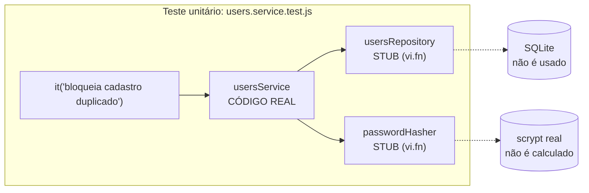

# 03 · Testes Unitários do ms-users

> **Etapa 2 — Microsserviço de Usuários (ms-users)**
>
> Este documento explica o raciocínio por trás do isolamento dos testes unitários: o que é substituído, por quê, e como isso se traduz em código com Vitest. Ele também mostra como rodar os testes e como verificar que eles realmente protegem o código. A arquitetura do serviço está em [01-infraestrutura-ms-users.md](./01-infraestrutura-ms-users.md) e as regras que os testes cobrem estão em [02-crud-e-autenticacao.md](./02-crud-e-autenticacao.md).

---

## 1. O que é um teste unitário neste projeto

Um **teste unitário** verifica uma unidade de código (um service, uma função, um middleware) **isoladamente**. Isso significa que:

- o banco de dados **não** é usado;
- a rede **não** é usada;
- o hash scrypt de verdade, na maioria dos casos, **não** é calculado;
- o relógio e a aleatoriedade **não** influenciam o resultado.

Se um teste unitário falha, o defeito está na unidade testada. Não há dúvida sobre onde procurar.

**Pergunta que o teste responde:** *"Dado que as dependências se comportam de tal forma, esta unidade toma a decisão certa?"*

**Pergunta que o teste NÃO responde:** *"O banco aceita este SQL?"* ou *"A rota responde 201?"*. Essas perguntas pertencem aos testes de integração, que ficam para a próxima etapa.

---

## 2. A anatomia de um teste: AAA

Todos os testes deste projeto seguem o padrão **Arrange, Act, Assert**:

```js
it('bloqueia o cadastro quando o e-mail já existe, sem gerar hash nem gravar', async () => {
  // Arrange: prepara o cenário
  usersRepository.findByEmail.mockResolvedValue({ id: 7, email: 'ana@exemplo.com' });

  // Act: executa a ação
  await expect(usersService.register(ENTRADA_VALIDA)).rejects.toThrow(ConflictError);

  // Assert: verifica o resultado e os efeitos colaterais
  expect(passwordHasher.hash).not.toHaveBeenCalled();
  expect(usersRepository.create).not.toHaveBeenCalled();
});
```

| Fase | O que faz | Erro comum |
|---|---|---|
| **Arrange** | Configura os stubs e os dados de entrada | Configurar coisas que o teste não usa, o que polui a leitura |
| **Act** | Chama a função testada, uma única vez | Testar várias ações em um mesmo `it` |
| **Assert** | Verifica o retorno e as interações | Verificar só o retorno, sem checar o que **não** deveria ter acontecido |

**A última linha do exemplo é a mais importante.** O teste verifica que `create` **não foi chamado**. Um teste que só confere a mensagem de erro deixaria passar um código que grava o usuário e depois lança o erro.

---

## 3. Vocabulário dos dublês

"Dublê" (*test double*) é o termo genérico para qualquer substituto de uma dependência real. Existem variações, e vale conhecer a diferença:

| Tipo | Definição | Usado aqui para |
|---|---|---|
| **Dummy** | Objeto preenchido só para satisfazer a assinatura, sem ser usado | Não usamos |
| **Fake** | Implementação funcional mais simples, como um repositório em um `Map` | Não usamos. Seria uma alternativa válida |
| **Stub** | Devolve respostas pré-programadas. Controla **o que a unidade recebe** | `mockResolvedValue`, `mockReturnValue` |
| **Spy** | Observa chamadas, mantendo a implementação real | Não usamos |
| **Mock** | Registra chamadas e permite **verificar** o que aconteceu | `toHaveBeenCalledWith`, `not.toHaveBeenCalled` |

Na prática, os nossos dublês são `vi.fn()`, uma função falsa do Vitest que pode ser **as duas coisas ao mesmo tempo**: stub (quando recebe um retorno configurado) e mock (quando o teste verifica suas chamadas).

A distinção importa porque cada uso responde a uma pergunta diferente:

- **Stub:** "a unidade faz a coisa certa **com esta entrada**?"
- **Mock:** "a unidade **chamou** a dependência do jeito certo, ou **deixou de chamar** quando deveria?"

---

## 4. O isolamento na prática



O `usersService` é o único código real do teste. Ele recebe as dependências pelo construtor (`createUsersService({ usersRepository, passwordHasher })`), e o teste entrega objetos com a mesma forma, mas controlados.

Essa é a razão de a injeção de dependências, explicada no documento 01, ser tão importante. Sem ela, o teste teria de usar `vi.mock` para interceptar o módulo do banco, o que é mais frágil e mais difícil de ler.

---

## 5. Os dublês reutilizáveis: `tests/unit/doubles/index.js`

```js
export function createUsersRepositoryStub() {
  return {
    create: vi.fn(),
    findById: vi.fn(),
    findByEmail: vi.fn(),
    list: vi.fn(),
    update: vi.fn(),
    delete: vi.fn(),
  };
}
```

O stub tem **a mesma forma** do repositório real: os mesmos métodos, com os mesmos nomes. Se alguém renomear `findByEmail` no repositório, o service deixa de funcionar, e o teste de integração aponta o problema. Os stubs não garantem essa sincronia sozinhos, o que é uma limitação conhecida dos dublês. Os testes de contrato, citados no documento 01, resolveriam isso.

### Por que os stubs são criados em `beforeEach`

Esta foi a lição mais instrutiva da etapa. Verificamos o comportamento do Vitest com um experimento:

```js
const hasherGlobal = createPasswordHasherStub();   // criado uma vez, no nível do módulo

it('teste 1 configura retorno e chama', async () => {
  hasherGlobal.hash.mockResolvedValue('configurado-no-teste-1');
  await hasherGlobal.hash('x');
  expect(hasherGlobal.hash).toHaveBeenCalledTimes(1);
});

it('teste 2 NÃO configura nada: deveria começar limpo', async () => {
  expect(hasherGlobal.hash).not.toHaveBeenCalled();          // passou: o histórico foi limpo
  expect(await hasherGlobal.hash('y')).toBeUndefined();      // FALHOU: o retorno do teste 1 vazou
});
```

O resultado mostrou que:

- `clearMocks: true` **limpa o histórico** de chamadas entre os testes;
- a **implementação** configurada com `mockResolvedValue` **continua valendo** no teste seguinte.

Por isso, todos os nossos stubs são criados dentro de `beforeEach`, e cada teste começa com dublês novos e sem configuração herdada.

> **Lição para a aula:** um teste que passa sozinho e falha junto com outros quase sempre tem estado compartilhado. Antes de atribuir a falha a um "teste instável", procure o estado que escapou.

---

## 6. Passo a passo: cadastro (`users.service.test.js`)

O arquivo tem 16 testes. Vamos olhar os três mais importantes para a regra de e-mail duplicado.

### 6.1 O caminho feliz

```js
it('cadastra o usuário quando o e-mail ainda não existe', async () => {
  // Stubs: definimos o que cada dependência devolve
  usersRepository.findByEmail.mockResolvedValue(null);
  passwordHasher.hash.mockResolvedValue('scrypt:salt:hash-falso');
  usersRepository.create.mockResolvedValue({ /* ... */ });

  const resultado = await usersService.register(ENTRADA_VALIDA);

  // Mocks: verificamos as interações
  expect(usersRepository.findByEmail).toHaveBeenCalledWith('ana@exemplo.com');
  expect(passwordHasher.hash).toHaveBeenCalledWith('senha-forte-123');
  expect(usersRepository.create).toHaveBeenCalledWith({
    name: 'Ana Souza',
    email: 'ana@exemplo.com',
    passwordHash: 'scrypt:salt:hash-falso',
  });

  expect(resultado).toEqual({ id: 1, name: 'Ana Souza', email: 'ana@exemplo.com', createdAt: '...' });
});
```

Repare em três detalhes:

1. A entrada é `'  Ana Souza  '` e `'Ana@Exemplo.com'`, mas as chamadas ao repositório recebem `'Ana Souza'` e `'ana@exemplo.com'`. O teste verifica a **normalização**, sem precisar de um teste separado para ela.
2. O `passwordHash` que vai para o `create` é o que o stub do hasher devolveu. O teste não sabe, nem precisa saber, como o hash é calculado.
3. O retorno não tem `passwordHash`. Há um teste separado para isso, justamente porque é uma regra de segurança.

### 6.2 O caso que mais importa: duplicata

```js
it('bloqueia o cadastro quando o e-mail já existe, sem gerar hash nem gravar', async () => {
  usersRepository.findByEmail.mockResolvedValue({ id: 7, email: 'ana@exemplo.com' });

  await expect(usersService.register(ENTRADA_VALIDA)).rejects.toThrow(ConflictError);

  expect(usersRepository.create).not.toHaveBeenCalled();   // a gravação NUNCA acontece
  expect(passwordHasher.hash).not.toHaveBeenCalled();      // o custo do hash também é evitado
});
```

Este teste mostra por que a verificação de **interação** é essencial. Um código que gravasse o usuário e depois lançasse o erro passaria no `rejects.toThrow`, mas falharia no `not.toHaveBeenCalled()`.

### 6.3 A normalização que evita duplicatas disfarçadas

```js
it('considera duplicado o mesmo e-mail com maiúsculas e espaços diferentes', async () => {
  usersRepository.findByEmail.mockResolvedValue({ id: 7, email: 'ana@exemplo.com' });

  await expect(
    usersService.register({ ...ENTRADA_VALIDA, email: '  ANA@exemplo.COM ' }),
  ).rejects.toThrow(ConflictError);

  expect(usersRepository.findByEmail).toHaveBeenCalledWith('ana@exemplo.com');
});
```

O stub `findByEmail` devolve sempre a mesma coisa, independentemente da entrada. Por isso, o teste verifica o **argumento** da chamada: é ali que a normalização precisa acontecer. O stub não tem como "perceber" uma normalização errada, e o mock tem.

### 6.4 Os demais testes de cadastro

| Teste | O que protege |
|---|---|
| `não devolve a senha nem o hash no retorno` | Vazamento de dados sensíveis na resposta |
| `rejeita senha curta sem consultar o repositório` | Validação acontece antes de qualquer acesso ao banco |
| `rejeita e-mail malformado com detalhe do campo` | O `details` aponta exatamente o campo com erro |
| `propaga falhas de infraestrutura do repositório sem transformá-las` | Um erro de banco não vira um falso `409` |

O último é um bom exemplo de como um stub simula falhas: `mockRejectedValue(new Error(...))` faz a dependência falhar, e o teste verifica que o service não engole o erro.

---

## 7. Passo a passo: autenticação (`auth.service.test.js`)

### 7.1 O teste que protege contra enumeração de usuários

```js
it('executa a verificação de senha mesmo quando o e-mail não existe', async () => {
  usersRepository.findByEmail.mockResolvedValue(null);
  passwordHasher.verify.mockResolvedValue(false);

  await expect(
    authService.login({ email: 'fantasma@exemplo.com', password: 'qualquer-senha' }),
  ).rejects.toBeInstanceOf(UnauthorizedError);

  expect(passwordHasher.verify).toHaveBeenCalledWith('qualquer-senha', DUMMY_PASSWORD_HASH);
});
```

Este é provavelmente o teste mais importante do arquivo, e ele não testa uma resposta, e sim um **comportamento**. A pergunta é: o código faz o mesmo trabalho nos dois casos?

Se alguém "otimizasse" o login e removesse o `verify` quando o usuário não existe, a resposta continuaria igual (`401`), e um teste baseado só no retorno não perceberia nada. A vulnerabilidade de enumeração por tempo voltaria sem que nenhum teste falhasse. Por isso, o teste verifica a **chamada** ao hasher com o hash de referência.

### 7.2 A mesma mensagem nos dois casos

```js
it('responde com a MESMA mensagem quando o e-mail não existe', async () => {
  usersRepository.findByEmail.mockResolvedValue(null);
  passwordHasher.verify.mockResolvedValue(false);

  await expect(
    authService.login({ email: 'fantasma@exemplo.com', password: 'qualquer-senha' }),
  ).rejects.toThrow(INVALID_CREDENTIALS_MESSAGE);
});
```

O teste importa a constante `INVALID_CREDENTIALS_MESSAGE` em vez de repetir o texto. Assim, se a mensagem mudar, a mudança fica em um lugar só, e o teste continua verificando a **igualdade** entre os dois casos.

---

## 8. Passo a passo: middleware de autenticação

O Express não é necessário nesses testes. O middleware é uma função comum, e basta passar objetos simples:

```js
it('anexa o usuário em req.user e segue o fluxo quando o token é válido', () => {
  tokenIssuer.verify.mockReturnValue({ sub: '5', email: 'ana@exemplo.com' });
  const req = { headers: { authorization: 'Bearer token-valido' } };

  authenticate(req, {}, next);

  expect(tokenIssuer.verify).toHaveBeenCalledWith('token-valido');
  expect(req.user).toEqual({ id: 5, email: 'ana@exemplo.com' });
  expect(next).toHaveBeenCalledWith();   // next() sem argumentos = segue para a rota
});
```

Três detalhes:

- `next` é um `vi.fn()`. Quando o middleware chama `next(erro)`, o erro fica registrado em `next.mock.calls`, e o teste inspeciona esse valor.
- `res` é `{}`, porque este middleware não responde diretamente. Ele só decide se a requisição segue ou não, e esse é exatamente o comportamento que queremos testar.
- `expect(next).toHaveBeenCalledWith()` verifica que `next` foi chamado **sem argumentos**. Isso diferencia "tudo certo" de "deu erro", porque, ao receber um argumento, o Express o trata como erro e pula as rotas seguintes.

---

## 9. Por que `security.test.js` não usa stubs

Este é o único arquivo de teste unitário que usa as implementações reais:

```js
it('rejeita token com algoritmo "none" (ataque clássico)', () => {
  const emissor = createTokenIssuer({ secret: SEGREDO, expiresInSeconds: 3600 });
  const tokenSemAssinatura = `${codificar({ alg: 'none', typ: 'JWT' })}.${codificar({ sub: '1' })}.`;

  expect(() => emissor.verify(tokenSemAssinatura)).toThrow();
});
```

A razão é simples: **um stub de criptografia não prova nada sobre criptografia**. Se o `verify` fosse substituído por `() => true`, um teste com stub passaria. O teste certo verifica a implementação real contra um token que **deve** ser rejeitado.

Hash e JWT são funções puras: recebem entrada e devolvem saída, sem banco e sem rede. Por isso, usá-las diretamente continua sendo um teste unitário. A regra é isolar **efeitos colaterais externos**, e não isolar toda e qualquer função.

Os casos cobertos são os ataques que realmente acontecem:

| Teste | Ataque que simula |
|---|---|
| `rejeita token com payload adulterado` | Trocar o `sub` de um token legítimo |
| `rejeita token assinado com outro segredo` | Forjar um token com uma chave que o atacante conhece |
| `rejeita token com algoritmo "none"` | Remover a assinatura e declarar `alg: none` |
| `rejeita token expirado` | Reutilizar um token antigo |

---

## 10. Provando que os testes protegem o código

Um teste que passa não garante que ele protege alguma coisa. Para verificar isso, usamos **teste de mutação**: introduzimos um defeito de propósito no código e confirmamos que a suíte falha.

Foram feitos dois experimentos. Na época, a suíte tinha 24 testes; os demais foram acrescentados depois.

**Mutação 1: remover a checagem de e-mail duplicado.**

```js
// Antes (correto)
if (existing) {
  throw new ConflictError('E-mail já cadastrado');
}

// Depois (mutado): a checagem deixa de agir
void existing;
```

Resultado: **2 testes falharam**, exatamente os dois que tratam duplicidade:

```text
× bloqueia o cadastro quando o e-mail já existe, sem gerar hash nem gravar
× considera duplicado o mesmo e-mail com maiúsculas e espaços diferentes
```

**Mutação 2: o login deixa de verificar a senha quando o usuário não existe.**

```js
// Depois (mutado): retorna antes de chamar o verify
if (!user) throw new UnauthorizedError(INVALID_CREDENTIALS_MESSAGE);
```

Resultado: **1 teste falhou**, o que protege a propriedade anti-enumeração:

```text
× executa a verificação de senha mesmo quando o e-mail não existe
```

Depois dos experimentos, os arquivos originais foram restaurados e a suíte voltou a passar. Essa é a forma correta de conduzir o experimento: sempre restaurar e confirmar.

### Como repetir o experimento

1. Abra `services/ms-users/src/services/users.service.js`.
2. Comente o bloco `if (existing) { throw ... }` dentro de `register`.
3. Rode `npm run test:unit`.
4. Confirme que os testes de duplicidade falham.
5. **Desfaça a alteração** e rode de novo para confirmar que tudo volta a passar.

---

## 11. Como rodar os testes

Todos os comandos são executados a partir da pasta `blog-microservices/`.

| Comando | O que faz |
|---|---|
| `npm run test:unit` | Roda só os testes unitários |
| `npm test` | Roda todos os projetos (unitários e de integração) |
| `npm run test:watch` | Modo interativo: reexecuta ao salvar um arquivo |
| `npm run test:coverage` | Roda os testes e gera o relatório de cobertura |
| `npx vitest run --project unit users.service` | Roda só um arquivo, pelo nome |
| `npx vitest run --project unit -t "duplicado"` | Roda só os testes cujo nome contém o texto |

### Saída esperada

```text
 ✓  unit  services/ms-users/tests/unit/auth.service.test.js (6 tests)
 ✓  unit  services/ms-users/tests/unit/authenticate.middleware.test.js (5 tests)
 ✓  unit  services/ms-users/tests/unit/security.test.js (13 tests)
 ✓  unit  services/ms-users/tests/unit/users.service.test.js (16 tests)

 Test Files  4 passed (4)
      Tests  40 passed (40)
```

### Relatório de cobertura

`npm run test:coverage` gera uma tabela no terminal e uma página HTML em `coverage/index.html`. Os números abaixo refletem a suíte unitária atual:

| Arquivo | Cobertura de linhas | Observação |
|---|---|---|
| `services/auth.service.js` | 100% | Login completo |
| `security/password.js` | 100% | Hash e verificação |
| `security/token.js` | 100% | Emissão e verificação |
| `middlewares/authenticate.js` | 100% | Proteção de rotas |
| `errors/app-error.js` | 100% | Hierarquia de erros |
| `services/users.service.js` | 97% | Só um caminho de leitura fica de fora |
| `validation/users.validation.js` | 82% | Ramos de erro menos comuns |
| `middlewares/error-handler.js` | 0% | Depende da resposta HTTP real, então é coberto pela integração |
| `app.js`, `container.js`, `server.js`, `db/`, `repositories/`, `routes/`, `controllers/` | 0% | Dependem de banco e de HTTP real |

A última linha é o motivo para a próxima etapa. Os 0% não são falha de cobertura: são a fronteira entre o que se testa de forma unitária e o que só faz sentido com a integração real. O repositório SQL, as rotas e o tratamento de erros HTTP precisam do banco e do Express de verdade, e isso é trabalho dos testes de integração com Supertest.

> A suíte unitária **não** mede se o SQL está correto. Um repositório com uma coluna escrita errada passaria em todos os testes desta etapa. Essa é uma limitação consciente, e a camada de integração existe justamente para ela.

---

## 12. Erros comuns e como corrigir

| Sintoma | Causa provável | Solução |
|---|---|---|
| `expected ... to be undefined` em um teste que passa sozinho | Implementação de stub vazando de outro teste | Crie o stub dentro de `beforeEach` |
| `toHaveBeenCalledWith` falha com argumento parecido | Normalização ou ordem de parâmetros diferente | Imprima `mock.calls` para ver o que foi realmente passado |
| `Cannot find module '../../src/...'` | Caminho relativo errado no teste | O teste fica em `tests/unit/`, então sobe dois níveis até `ms-users/` |
| Teste passa, mas não deveria | Assertion fraca, como só checar que não lançou erro | Verifique o tipo do erro e as chamadas feitas |
| Teste lento | Hash scrypt real sendo usado em um teste que deveria usar stub | Troque o hasher por `createPasswordHasherStub()` |
| `No test files found` | Arquivo fora do padrão `tests/unit/**/*.test.js` | Confira o nome: precisa terminar em `.test.js` |

---

## 13. Checklist para escrever um teste unitário

Antes de dar um teste por pronto, confirme:

- [ ] O nome descreve o **comportamento**, e não a implementação.
- [ ] O teste faz **uma** ação (Act) e verifica **um** comportamento.
- [ ] Os stubs são criados em `beforeEach`.
- [ ] Há pelo menos uma verificação do que **não** deveria acontecer (`not.toHaveBeenCalled`).
- [ ] O teste falharia se a regra fosse removida. Se não falharia, ele não protege nada.
- [ ] O teste não depende de horário, ordem de execução ou banco.

---

## 14. Exercícios

1. Escreva um teste para `usersService.update` que verifique que trocar **somente a senha** não chama `usersRepository.findByEmail`. Depois, confira se o teste passa com a implementação atual.
2. Faça a mutação do `assertOwner` (troque `actorId !== targetId` por `false`) e confirme quais testes falham. Você esperava esses?
3. Crie um stub de `usersRepository` que lance `new Error('timeout')` apenas em `create`, e escreva o teste que verifica que o cadastro falha sem retornar um perfil.
4. Explique, com suas palavras, por que `DUMMY_PASSWORD_HASH` precisa ter o **mesmo formato** de um hash real. O que aconteceria se fosse a string `'x'`?
