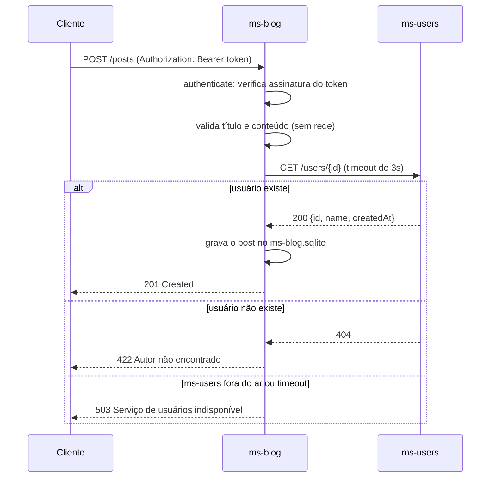
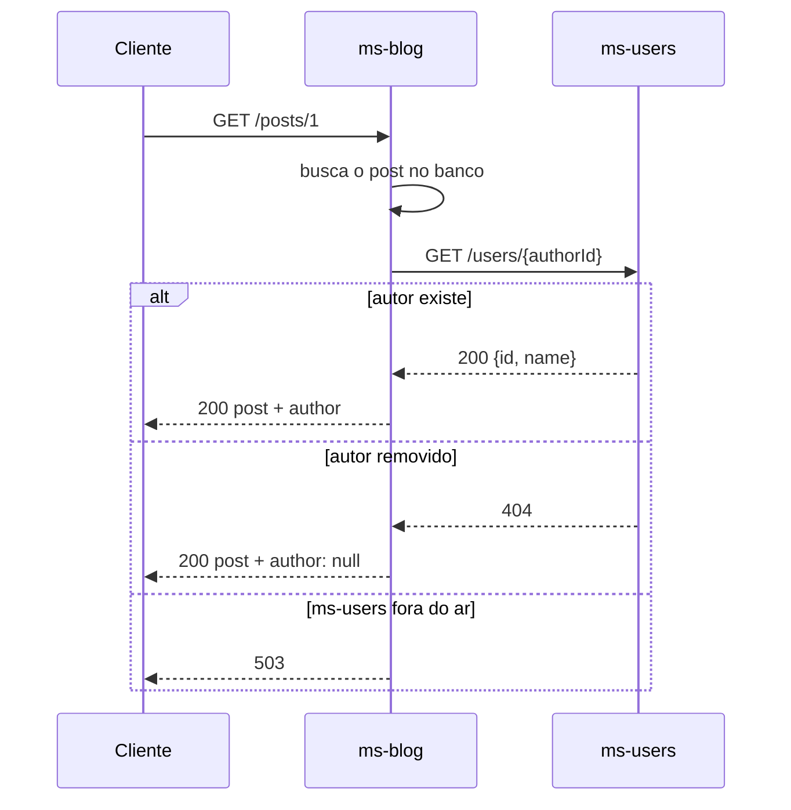

# 01 · Infraestrutura do ms-blog e comunicação com o ms-users

> **Etapa 3 — Microsserviço do Blog (ms-blog)**
>
> Este documento explica a infraestrutura do serviço de posts e, principalmente, como ele conversa com o ms-users. O CRUD de posts está em [02-crud-de-posts.md](./02-crud-de-posts.md). Os testes unitários estão em [03-testes-unitarios.md](./03-testes-unitarios.md).

---

## 1. O que muda em relação ao ms-users

O ms-blog foi construído com o mesmo padrão de camadas do ms-users. Quem já leu a Etapa 2 vai reconhecer quase todos os arquivos. Há três diferenças importantes:

| Aspecto | ms-users | ms-blog |
|---|---|---|
| Dados que possui | Usuários (nome, e-mail, hash) | Posts (título, conteúdo, `author_id`) |
| Emite tokens? | Sim (`jwt.sign`) | Não. Só verifica (`jwt.verify`) |
| Fala com outro serviço? | Não | Sim: consulta o ms-users por HTTP |

A terceira diferença é a que define esta etapa. Ela aparece em um único arquivo, `clients/users.client.js`, e o resto do serviço é organizado para isolá-la.

---

## 2. Árvore real do serviço

```text
services/ms-blog/
├── package.json
├── src/
│   ├── server.js                       ← abre a porta (único arquivo com listen)
│   ├── container.js                    ← conecta as peças (composition root)
│   ├── app.js                          ← rotas e middlewares, sem porta
│   ├── config.js                       ← lê e valida o ambiente (inclui a URL do ms-users)
│   ├── db/
│   │   └── database.js                 ← abre o SQLite e cria a tabela posts
│   ├── errors/
│   │   └── app-error.js                ← erros com status HTTP, incluindo 422 e 503
│   ├── security/
│   │   └── token-verifier.js           ← verifica JWT (não emite)
│   ├── validation/
│   │   └── posts.validation.js         ← regras de formato de título e conteúdo
│   ├── repositories/
│   │   └── posts.repository.js         ← único lugar com SQL de posts
│   ├── clients/
│   │   └── users.client.js             ← ÚNICO ponto de chamada HTTP ao ms-users
│   ├── services/
│   │   └── posts.service.js            ← regras do CRUD de posts
│   ├── controllers/
│   │   └── posts.controller.js
│   ├── routes/
│   │   └── posts.routes.js
│   └── middlewares/
│       ├── authenticate.js             ← exige token válido nas rotas de escrita
│       └── error-handler.js
└── tests/
    └── unit/
        ├── doubles/index.js            ← stubs do repositório e do cliente
        ├── posts.service.test.js
        ├── posts.validation.test.js
        ├── users.client.test.js
        ├── authenticate.middleware.test.js
        └── config.test.js
```

Em relação ao plano da Etapa 1, a estrutura ganhou `security/token-verifier.js`, `validation/` e `errors/`. Eles separam responsabilidades que, sem essa divisão, ficariam misturadas, exatamente como aconteceu no ms-users.

---

## 3. Duas mudanças no contrato da Etapa 1

O documento 01 da Etapa 1 previa `POST /posts` com `authorId` no corpo. Ao desenhar o serviço, esse formato se mostrou inseguro, e o contrato foi alterado.

**Antes (plano):**

```http
POST /posts
{ "title": "...", "content": "...", "authorId": 1 }
```

Qualquer pessoa poderia publicar em nome de outra, bastando trocar o número.

**Agora:**

```http
POST /posts
Authorization: Bearer <token>
{ "title": "...", "content": "..." }
```

O autor passa a ser o dono do token (`req.user.id`). O campo `authorId` deixa de vir do cliente. O ms-blog continua confirmando, no ms-users, que esse autor existe. Esse é o vínculo lógico com o usuário que o enunciado pede.

A segunda mudança é a forma de confiar no token. O ms-blog não consulta o ms-users para autenticar cada requisição. Ele verifica a assinatura do JWT com o mesmo `JWT_SECRET` que o ms-users usou para assinar. Essa decisão tem uma consequência, discutida na seção 9.

---

## 4. Configuração: `src/config.js`

```js
export function loadConfig(env = process.env) {
  const jwtSecret = env.JWT_SECRET ?? '';
  if (jwtSecret.length < MIN_JWT_SECRET_LENGTH) {
    throw new Error(`JWT_SECRET é obrigatório e deve ter pelo menos ${MIN_JWT_SECRET_LENGTH} caracteres`);
  }

  return Object.freeze({
    port: parsePositiveInteger(env.BLOG_SERVICE_PORT, 'BLOG_SERVICE_PORT', DEFAULT_PORT),
    dbPath: env.BLOG_DB_PATH || DEFAULT_DB_PATH,
    usersService: Object.freeze({
      baseUrl: parseHttpUrl(env.USERS_SERVICE_URL || DEFAULT_USERS_SERVICE_URL, 'USERS_SERVICE_URL'),
      timeoutMs: parsePositiveInteger(env.USERS_SERVICE_TIMEOUT_MS, 'USERS_SERVICE_TIMEOUT_MS', DEFAULT_USERS_TIMEOUT_MS),
    }),
    jwt: Object.freeze({ secret: jwtSecret }),
  });
}
```

### Pontos que merecem atenção

**A URL do ms-users é validada na inicialização.** Um endereço malformado (`isto-nao-e-url`) ou com protocolo errado (`ftp://`) impede o serviço de subir, com uma mensagem clara. Sem essa validação, o erro apareceria só na primeira chamada, longe da causa.

**A barra final é removida.** `http://ms-users:3001/` vira `http://ms-users:3001`. Sem isso, a URL montada seria `http://ms-users:3001//users/1`, e alguns servidores tratam `//` como rota diferente.

**O `JWT_SECRET` precisa ser idêntico ao do ms-users.** Se os dois serviços tiverem segredos diferentes, todo token emitido pelo ms-users será recusado pelo ms-blog com `401`. Esse é o tipo de erro que os testes de integração da Etapa 4 vão detectar.

---

## 5. Banco de dados: `src/db/database.js`

```sql
CREATE TABLE IF NOT EXISTS posts (
  id          INTEGER PRIMARY KEY AUTOINCREMENT,
  title       TEXT    NOT NULL,
  content     TEXT    NOT NULL,
  author_id   INTEGER NOT NULL,
  created_at  TEXT    NOT NULL,
  updated_at  TEXT    NOT NULL
);

CREATE INDEX IF NOT EXISTS idx_posts_author_id ON posts (author_id);
```

### Por que a tabela não tem nome nem e-mail do autor?

Essa é a regra de **banco por serviço** da Etapa 1, aplicada na prática. O ms-blog guarda o `author_id` e nada mais sobre o autor. Se o nome da pessoa mudar no ms-users, o blog continua correto, porque ele sempre busca o nome na hora de exibir o post.

A alternativa, copiar o nome para a tabela de posts, parece mais simples. Ela cria dois problemas: o nome copiado fica desatualizado quando a pessoa muda de nome, e uma pessoa pode aparecer com dois nomes diferentes em posts antigos e novos.

### Por que o `author_id` não tem `FOREIGN KEY`?

O banco do ms-users é outro arquivo. O SQLite não consegue impor uma chave estrangeira entre dois arquivos. A integridade passa a ser garantida pela **API**: o `POST /posts` só grava se o ms-users confirmar que o autor existe. O índice `idx_posts_author_id` existe para acelerar a busca de posts por autor.

---

## 6. A fronteira de rede: `src/clients/users.client.js`

Este é o arquivo mais importante da etapa. Toda chamada ao ms-users passa por ele.

```js
export function createUsersClient({ baseUrl, timeoutMs, fetchImpl = globalThis.fetch }) {
  return Object.freeze({
    async findUserById(userId) {
      const url = `${baseUrl}/users/${encodeURIComponent(String(userId))}`;

      let response;
      try {
        response = await fetchImpl(url, {
          headers: { accept: 'application/json' },
          signal: AbortSignal.timeout(timeoutMs),
        });
      } catch {
        throw new ServiceUnavailableError('Serviço de usuários indisponível');
      }

      if (response.status === 404) {
        return null;
      }

      if (!response.ok) {
        throw new ServiceUnavailableError(`Serviço de usuários respondeu com status ${response.status}`);
      }

      let body;
      try {
        body = await response.json();
      } catch {
        throw new ServiceUnavailableError('Resposta inválida do serviço de usuários');
      }

      return { id: body.id, name: body.name };
    },
  });
}
```

### A tradução das respostas

Este é o contrato entre os dois serviços, visto do lado do ms-blog:

| O que o ms-users fez | O que o cliente devolve | Por quê |
|---|---|---|
| `200` com o usuário | `{ id, name }` | O usuário existe |
| `404` | `null` | Não é falha de infraestrutura. É uma resposta válida, "esse autor não existe" |
| `500`, `503` ou outro erro de servidor | `ServiceUnavailableError` (503) | O ms-users está com problema |
| Conexão recusada ou DNS falhou | `ServiceUnavailableError` (503) | Não foi possível falar com o serviço |
| Nenhuma resposta dentro do prazo | `ServiceUnavailableError` (503) | Timeout, tratado abaixo |
| Corpo que não é JSON | `ServiceUnavailableError` (503) | Resposta inesperada |

**`404` e falha de infraestrutura são coisas diferentes.** Se o cliente tratasse todo erro como "autor não existe", um ms-users fora do ar faria o blog responder `422` ("autor inválido") em vez de `503` ("tente de novo mais tarde"). O cliente errado mentiria para quem está do outro lado.

### O timeout

```js
signal: AbortSignal.timeout(timeoutMs),
```

Sem timeout, uma chamada presa segura a requisição do blog indefinidamente. Com muitas requisições presas, o blog esgota seus recursos e também para de responder, o que espalha a falha. O `AbortSignal.timeout` cancela a chamada depois de `USERS_SERVICE_TIMEOUT_MS` (3000 ms por padrão). O cancelamento faz o `fetch` lançar um erro, e o `catch` o traduz para `503`.

### Por que o cliente copia só `id` e `name`?

```js
return { id: body.id, name: body.name };
```

O ms-users devolve também `createdAt`. O blog não precisa dele, e cada campo copiado é uma dependência a mais. Se o ms-users renomear `createdAt`, o blog não quebra. Esse é o princípio de **acoplamento mínimo**: depender só do que se usa.

---

## 7. Fluxos entre os serviços

### 7.1 Criar um post



A ordem das verificações segue um critério: as mais baratas vêm primeiro. Um título vazio é recusado sem nenhuma chamada de rede. Uma requisição sem token é recusada antes de qualquer validação.

### 7.2 Ler um post com o autor



Esse fluxo tem uma decisão que vale destacar. Se o autor foi removido do ms-users, o post **continua existindo** e volta com `author: null`. O post é um conteúdo do blog, e a ausência de um autor não justifica escondê-lo.

Já se o ms-users está fora do ar, a resposta é `503`, e não um post sem autor. Um `null` aqui induziria a erro: pareceria que o autor foi apagado, quando na verdade só não foi possível consultá-lo.

---

## 8. Como rodar os dois serviços juntos

A partir da raiz do projeto (`blog-microservices/`), com o `.env` criado a partir do `.env.example`:

```bash
# terminal 1: o ms-users precisa estar no ar primeiro
npm run start -w @blog/ms-users

# terminal 2
npm run start -w @blog/ms-blog
```

Saída esperada no segundo terminal:

```text
[ms-blog] ouvindo na porta 3002 (ambiente: development, ms-users: http://localhost:3001)
```

### Verificação rápida

```bash
# cadastra um autor no ms-users
curl -X POST http://localhost:3001/users \
  -H "Content-Type: application/json" \
  -d '{"name":"Ana Souza","email":"ana@exemplo.com","password":"senha-forte-123"}'

# pega o token
TOKEN=$(curl -s -X POST http://localhost:3001/auth/login \
  -H "Content-Type: application/json" \
  -d '{"email":"ana@exemplo.com","password":"senha-forte-123"}' \
  | python3 -c "import json,sys; print(json.load(sys.stdin)['accessToken'])")

# cria um post no ms-blog com esse token
curl -X POST http://localhost:3002/posts \
  -H "Content-Type: application/json" \
  -H "Authorization: Bearer $TOKEN" \
  -d '{"title":"Meu primeiro post","content":"Escrevendo sobre microsserviços pela primeira vez."}'
```

---

## 9. Verificação de ponta a ponta feita durante o desenvolvimento

Os dois serviços foram executados como processos reais, cada um com seu banco, e o fluxo foi percorrido por HTTP. O resultado de cada passo:

| Passo | Resposta | O que prova |
|---|---|---|
| Criar post com token válido | `201` | Autenticação, validação e consulta ao ms-users funcionam juntos |
| `GET /posts/1` | `200`, com `author: {id: 1, name: "Ana Souza"}` | O blog realmente buscou o nome no ms-users |
| Token adulterado | `401` | A assinatura é verificada |
| Sem token | `401` | A rota de escrita exige autenticação |
| Título só com espaços | `400` | A validação de formato roda antes da rede |
| Bia tenta editar post da Ana | `403` | A regra de dono é aplicada |
| Autor da Ana edita o próprio post | `200` | O caminho feliz da atualização |
| Token de usuário inexistente | `422` | A checagem de autor no ms-users é feita de verdade |
| **ms-users derrubado**, `GET /posts` | `200` | A lista não depende do ms-users |
| **ms-users derrubado**, `GET /posts/1` | `503` | O autor não pode ser consultado |
| **ms-users derrubado**, criar post | `503` | Nada é gravado sem confirmar o autor |
| **ms-users derrubado**, editar o próprio post | `200` | A edição não depende do ms-users |

A última linha da tabela é a mais útil didaticamente. Ela mostra que a dependência entre serviços é **local**: só as operações que precisam do autor falham quando o ms-users cai.

> **Lição de ambiente:** a primeira tentativa desse teste deu resultado errado. A queda do ms-users não aconteceu, porque um processo de uma etapa anterior continuava rodando na porta 3001 e respondia no lugar dele. Por isso, o passo "ms-users fora do ar" retornou `200`, e não `503`. Um teste de falha que não falha é tão perigoso quanto um teste que nunca roda. Antes de confiar no cenário, confirme que ele está no estado que você pensa.

---

## 10. Decisões e trade-offs

| Decisão | Alternativa | Motivo |
|---|---|---|
| `authorId` vem do token | `authorId` no corpo | Impede publicar em nome de outra pessoa |
| Verificar JWT localmente | Perguntar ao ms-users a cada requisição | Não cria dependência do ms-users para toda escrita |
| `JWT_SECRET` compartilhado | Chave pública/privada (RS256) | Mais simples para a aula. Ver seção 11 |
| Cliente HTTP isolado em um arquivo | Chamadas `fetch` espalhadas | Um único lugar para trocar, testar e fazer o timeout |
| `404` vira `null` no cliente | `404` vira erro | Separa "não existe" de "não consegui verificar" |
| Lista sem o nome do autor | Chamar o ms-users para cada post | Evita uma chamada HTTP por post (o problema N+1) |
| Código de erro duplicado entre serviços | Pacote compartilhado | Serviços independentes. Um pacote comum criaria acoplamento de versão |

---

## 11. Trade-off importante: segredo compartilhado

Com HS256, o mesmo segredo serve para emitir e para verificar. Isso significa que **qualquer serviço que verifica tokens também consegue forjá-los**. O ms-blog, que só deveria ler, teria poder para criar tokens de qualquer usuário.

A solução de produção é usar assinatura assimétrica (RS256): o ms-users guarda a chave privada para assinar, e o ms-blog recebe apenas a chave pública para verificar. Assim, o blog pode confirmar um token, mas não criar um. Essa troca fica como exercício para a aula, e o código do blog já está organizado para recebê-la: basta trocar o `token-verifier.js`.

---

## 12. Problemas comuns

| Sintoma | Causa | Solução |
|---|---|---|
| `POST /posts` retorna `401` com token recém-emitido | `JWT_SECRET` diferente entre os serviços | Confira que o `.env` é o mesmo para os dois |
| `POST /posts` retorna `503` | ms-users não está no ar ou `USERS_SERVICE_URL` aponta para o lugar errado | Suba o ms-users primeiro. Confira a URL no `.env` |
| `USERS_SERVICE_URL não é uma URL válida` | Valor sem `http://` | Use, por exemplo, `http://localhost:3001` |
| `EADDRINUSE` na porta 3002 | Outro processo usa a porta | Encontre o processo com `ps` e encerre-o pelo PID |
| `GET /posts/1` retorna `200` com ms-users desligado | Um processo antigo continua na porta 3001 | Confira com `ps` e `curl` que a porta realmente está fechada |
